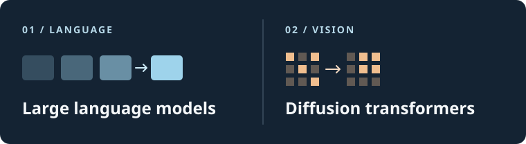

# yuanY

Final-year undergraduate in **Software Engineering at Tsinghua University**, interested in **large language models** and **diffusion transformers**.

## Research interests

- **Large language models (LLMs).** How do training and inference choices affect the behavior and efficiency of language models?
- **Diffusion transformers (DiT).** How do architecture and sampling choices affect visual generation quality and compute cost?

## Education

| Stage | Program |
| :--- | :--- |
| Current | Software Engineering, Tsinghua University · final-year undergraduate |
| Planned | Two-year professional master's in [Big Data Technology and Engineering](https://www.sigs.tsinghua.edu.cn/en/2020/0914/c1668a18571/page.htm), Tsinghua Shenzhen International Graduate School (SIGS) |
